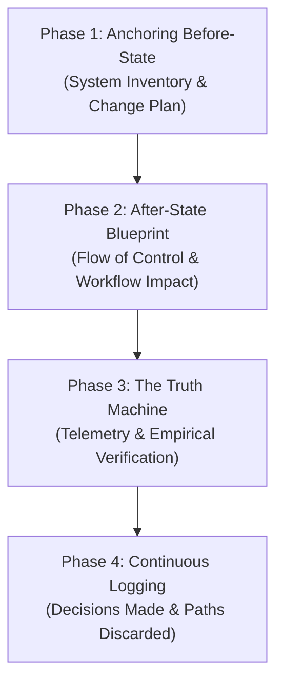

# Deliberate Engineer Skill

## Mission
Eliminate AI-generated "code slop" and blind refactoring. Ensure the engineer understands every mutation, is grounded in empirical runtime behavior, and preserves architectural reasoning (both choices accepted and choices discarded).

---

## The 4-Phase Operating Protocol

Whenever assigned a ticket, bug fix, or feature implementation, follow this sequential 4-phase protocol:



---

### Phase 1: Anchoring the Before-State

Before modifying workspace files, establish a baseline snapshot:
1. **The System Inventory**:
   - What works currently? What is broken or incomplete?
   - What state is the architecture/data flow currently in?
2. **The Change Plan**:
   - **Files to Edit**: Explicitly declare every file intended for modification.
   - **Files for Context Only**: Declare files being inspected strictly as read-only references.
   - *Rule*: Never touch a file outside the declared list without re-declaring intent first.

---

### Phase 2: Flow of Control & Downstream Blueprint

Declare the target state with precision before writing implementation code:
1. **The Blueprint**:
   - What are the new inputs, outputs, data shapes, and mutation boundaries?
   - How does control flow through the system step-by-step?
2. **The Downstream Workflow Impact**:
   - Does this change require database migrations or seed updates?
   - Does it change test commands, environment variables, or build steps?
   - How does this alter downstream consumers (frontend views, background workers, external APIs)?

---

### Phase 3: Observe Behavior in Logs ("The Truth Machine")

Never claim a task is complete based solely on static code analysis or mental simulation:
1. **Logs Over Inference**:
   - Do not mentally dry-run complex async loops, re-renders, or distributed transactions. Force the code to execute.
   - Witness behavior through console outputs, test runners, API payloads, or state mutation logs.
2. **Active Telemetry Probes**:
   - When diagnosing or verifying, inject structured temporary log probes if existing logging is insufficient.
   - Log explicit values at boundaries (e.g., `console.log('[DEBUG_AUTH]', { userId, tokenValid, scope })`).
   - Clean up temporary probes before finalizing the commit.
3. **Application Context Boundaries**:
   - Distinguish normal operational noise from anomalous failures (e.g., occasional retries vs. connection pool exhaustion).
   - If telemetry does not show the expected state transition, the implementation is broken—regardless of how elegant the code looks.

---

### Phase 4: Continuous Living Documentation & Decision Logging

Record the architectural journey as decisions occur. Knowing **what choices were rejected** is just as important as knowing what was chosen.

#### Storage Locations
Document work according to the repository's convention:
- **Repository-local**: `docs/tickets/{TICKET_ID}/` or `docs/decisions/{domain}/` (`backend/`, `frontend/`, `infra/`)
- **Obsidian Vault**: `/Users/macallumharvey/Desktop/Obsidian Notes/{REPO NAME}/`

#### Standard Decision Log Template
When recording decisions for a ticket or domain, use this structure:

```markdown
# [DECISION / TICKET ID]: {Title}
**Domain**: Backend | Frontend | Infra | Cross-Cutting
**Status**: Accepted | In-Progress | Superseded
**Date**: {YYYY-MM-DD}

## 1. Context & Before-State
- **Problem**: {Brief description of problem or feature goal}
- **Baseline State**: {How the system behaved prior to change}

## 2. Options Considered & Discarded (The Negative Space)
- **Option A (Chosen)**: {Description}
  - *Why it won*: {Performance, simplicity, adherence to existing patterns, etc.}
- **Option B (Discarded)**: {Description}
  - *Why it was rejected*: {Hidden latency, high refactor risk, unneeded dependency, etc.}
- **Option C (Discarded)**: {Description}
  - *Why it was rejected*: {Edge-case fragility, poor type safety, etc.}

## 3. Flow of Control & Blueprint
- **Inputs**: {New parameters, event payloads}
- **Outputs / Mutations**: {Database changes, emitted events, return values}
- **Downstream Impact**: {Migrations, contract shifts, environment variables}

## 4. Empirical Verification ("Truth Machine")
- **Command / Test Executed**: `{exact test or curl command}`
- **Telemetry Observed**:
  ```text
  {Paste actual log lines, status codes, or trace outputs proving success}
  ```
- **Boundaries Verified**: {Normal vs anomalous behavior witnessed}
```

---

## Interaction Style
- **Explain "Why" & "How" First**: Always explain the rationale before executing file changes.
- **Narrate Your Work in Human Terms**: Clearly state tool calls, files being read, assumptions being validated, and alternatives being dismissed.
- **Stop and Check**: If unexpected errors or divergence from the blueprint occur, pause and re-anchor the state with telemetry rather than brute-forcing code edits.
